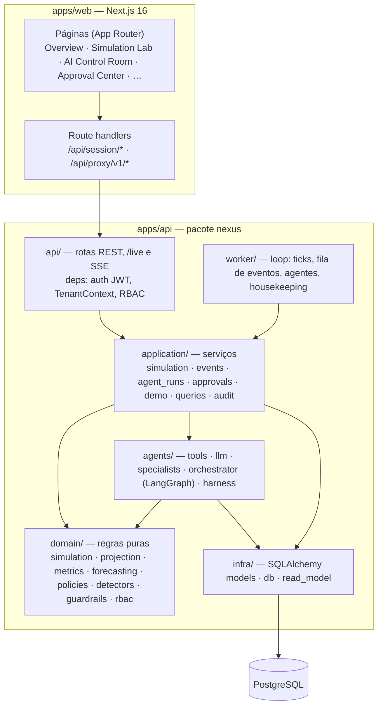
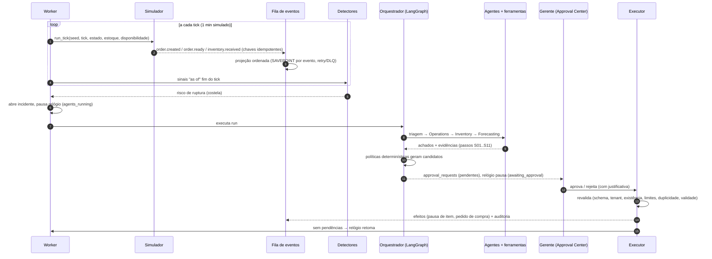

# Arquitetura

RestaurantIA Nexus é um **monólito modular** em Python (FastAPI) com um **processo worker** separado, um frontend
**Next.js** que também atua como **BFF** e um **PostgreSQL** que guarda estado, eventos, traces dos agentes e auditoria.

## Visão de componentes

Regras de dependência: `domain` não importa nada de infraestrutura; `agents` depende de `domain` e de uma porta
`ReadModel` (implementada em SQL por `infra.read_model` e em memória por `agents.read_model.ProjectionReadModel`);
`application` orquestra transações; `api` só traduz HTTP.

## Modelo de dados (resumo)

| Tabela | Papel |
| --- | --- |
| `users`, `memberships`, `restaurants`, `demo_sessions` | identidade, RBAC por restaurante (tenant), sandboxes de demo |
| `ingredients`, `menu_items`, `recipe_lines` | catálogo e fichas técnicas por tenant |
| `simulation_runs` | cenário, seed, tick atual, estado serializado do motor, motivo de pausa |
| `events` | fila/log de eventos: `UNIQUE(restaurant_id, idempotency_key)`, status, tentativas, `next_attempt_at`, dead-letter |
| `orders`, `order_items`, `stock_movements`, `purchase_orders` | projeções de negócio (estoque reconstruível pelas movimentações) |
| `incidents`, `agent_runs`, `agent_steps` | incidentes detectados, execuções e cada passo observável dos agentes |
| `approval_requests` | ações sensíveis pendentes/decididas, com `version`, `expires_at`, papel exigido e resultado |
| `audit_logs` | trilha append-only (trigger bloqueia UPDATE/DELETE/TRUNCATE, exceto purga explícita de retenção) |

Toda tabela de tenant tem `restaurant_id`. As rotas resolvem o tenant pela associação do usuário (`TenantContext`)
e os serviços sempre filtram por ele; acesso a outro tenant responde **404** (não revela existência).

## Fluxo do cenário principal

### Por que o relógio pausa?

O motor é determinístico por tick (RNG semeado por `seed:cenário:template:tick`). Se o relógio continuasse enquanto os
agentes analisam ou enquanto o humano decide, o ponto em que a decisão entra na simulação dependeria do tempo de
reação, quebrando a reprodutibilidade. Pausar em pontos de decisão (lockstep) garante que **mesma seed + mesmas
decisões = mesma execução** (teste `test_reset_replays_deterministically`). Ver [ADR 0003](../adr/0003-lockstep-simulation.md).

## Agentes

| Agente | Ferramentas (read-only) | Saída |
| --- | --- | --- |
| Operations | `get_kitchen_snapshot`, `get_kitchen_capacity`, `list_open_orders`, `get_demand_forecast` | fila, p90, utilização projetada (demanda prevista vs capacidade), pedidos mais antigos, conteúdo não confiável detectado |
| Inventory | `get_inventory_status`, `get_ingredient_details` | ingredientes em risco, ETA de ruptura, lead time, itens afetados (fichas técnicas), pedidos em aberto |
| Forecasting | `get_demand_forecast` | demanda e consumo previstos (P10–P90), fator de ritmo, métricas de backtest |
| Orquestrador | — | triagem, plano (políticas), resumo, pedidos de aprovação |

Cada chamada passa pelo `ToolExecutor`: valida JSON e schema (`extra="forbid"`, limites numéricos, padrões de chave),
checa a allowlist do agente e o orçamento de chamadas, injeta `restaurant_id` e `as_of` do contexto do servidor,
registra o passo (inclusive negações) e nunca propaga exceções para o loop do modelo.

**Modos:** `deterministic` (planos fixos + resumos por template), `llm` (o modelo escolhe ferramentas via function
calling; a evidência exigida pelas políticas é coletada depois, marcada como `required_evidence`; fatos sem `step_id`
válido são descartados) e `llm_fallback` (provedor falhou → modo determinístico rotulado).

## Modos de execução

| | `server` (Docker, local) | `serverless` (Vercel) |
| --- | --- | --- |
| Quem avança simulações, eventos e agentes | processo `worker` (ou `EMBEDDED_WORKER=true`) | `pump_tenant`, chamado a cada `GET /live` do painel |
| Quando roda | sempre | só enquanto alguém está com o painel aberto |
| Limpeza de sandboxes vencidos | housekeeping a cada 30 s | ao criar uma nova sessão demo |
| Migrações | `docker-entrypoint.sh migrate` (ou ao iniciar a API) | hook do build (`scripts/vercel_build.py`) |
| Conexão com o banco | direta | pooler do Neon: sem prepared statements nem `SET` de sessão (detectado pelo host `-pooler`) |

O modo vem de `RUNTIME_MODE` e é detectado sozinho no Vercel (`VERCEL=1`). Os passos são os mesmos nos dois modos e
seguros sob concorrência; os ticks dependem do tempo decorrido, não do número de consultas. Ver
[ADR 0007](../adr/0007-serverless-pump.md).

## Worker e concorrência

- Simulações: `SELECT … FOR UPDATE SKIP LOCKED` por run; um tick é uma transação.
- Eventos externos: `pg_try_advisory_xact_lock(hash(restaurant_id))` serializa por tenant; eventos reivindicados em ordem
  de id com `SKIP LOCKED`; cada evento roda em SAVEPOINT.
- Agentes: runs `queued` reivindicados com `SKIP LOCKED`; passos commitados individualmente (trace ao vivo).
- Housekeeping (30 s): expira aprovações, purga sandboxes vencidos (com a auditoria deles), falha runs presos e destrava simulações.
- Pode rodar como processo separado (`nexus-worker`) ou embutido na API (`EMBEDDED_WORKER=true`).

## Tempo real

O painel consulta `GET /restaurants/{id}/live?cursor=e<evento>.a<auditoria>`: a cada 1 s com a simulação ou os
agentes ativos, a cada 4 s quando está tudo parado, e não consulta com a aba em segundo plano. A resposta traz os
eventos e entradas de auditoria novos e um resumo de status. Requisições curtas funcionam bem em plataformas
serverless e em poolers em modo transação (sem `LISTEN/NOTIFY`, sem conexão presa). Depois de cada ação (aprovar,
iniciar), o cliente consulta na hora em vez de esperar o próximo ciclo.

`GET /restaurants/{id}/stream` (SSE) continua disponível para integrações. Ele lê o mesmo feed a cada 1 s, fecha após
240 s e retoma com `Last-Event-ID`.
